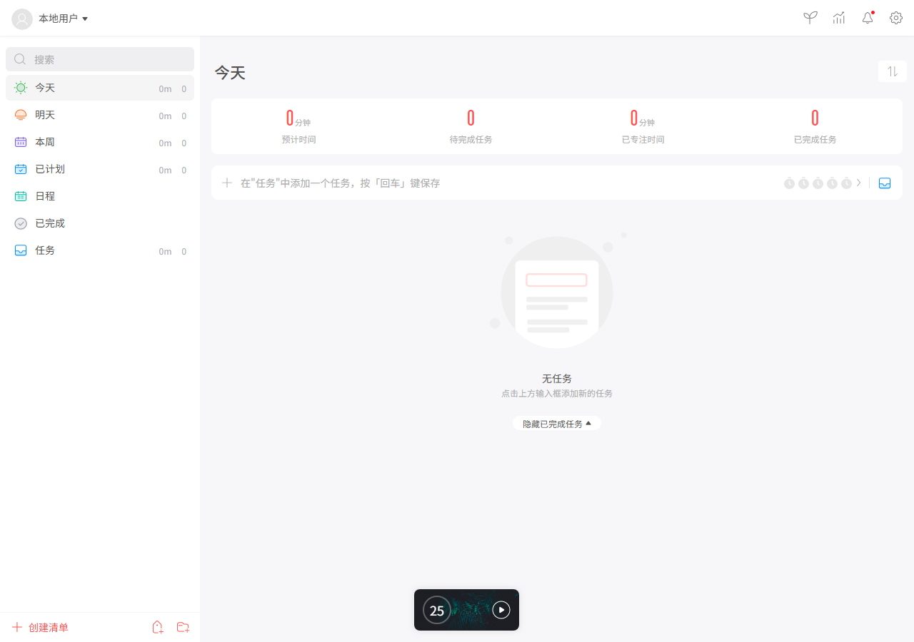
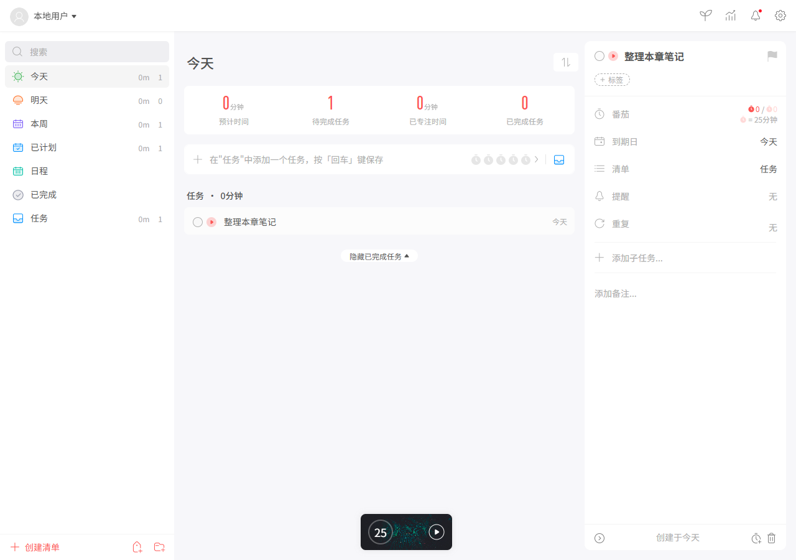
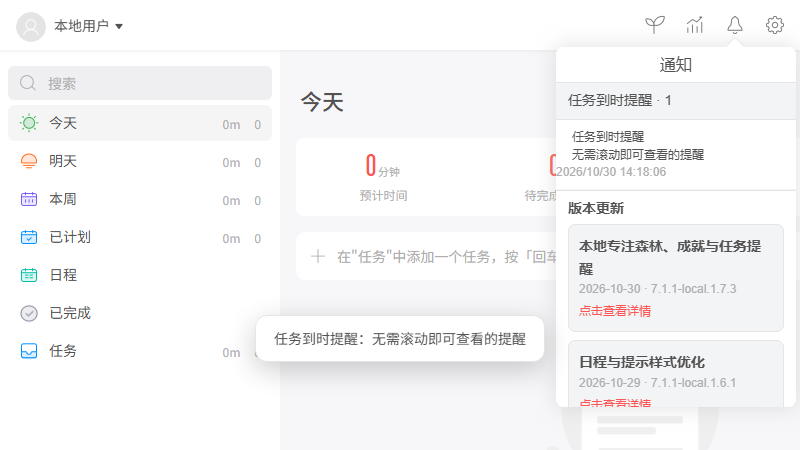
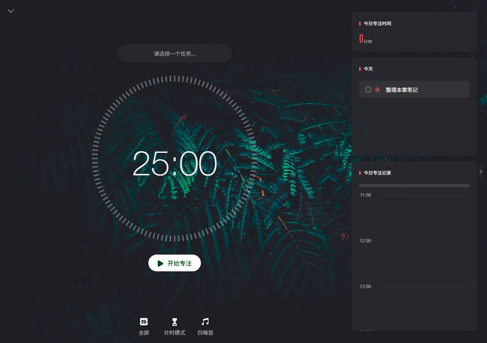
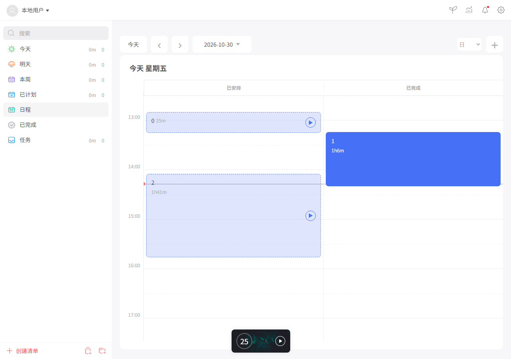
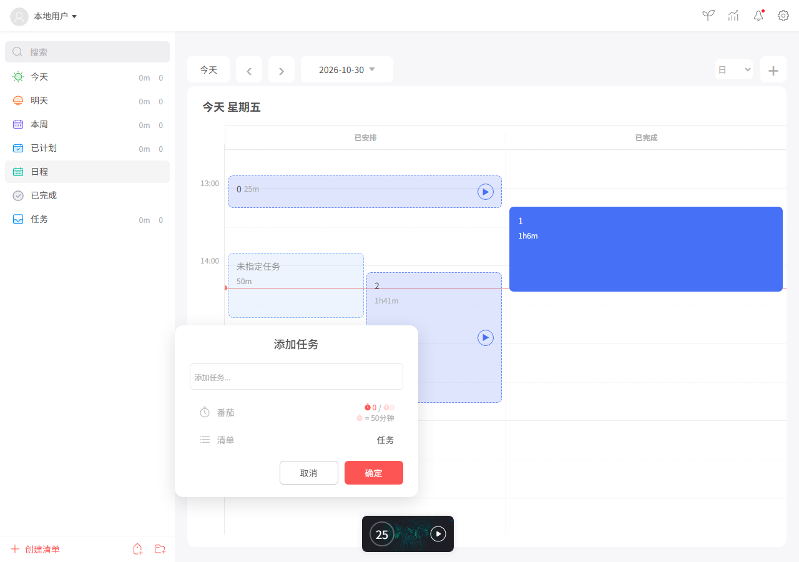
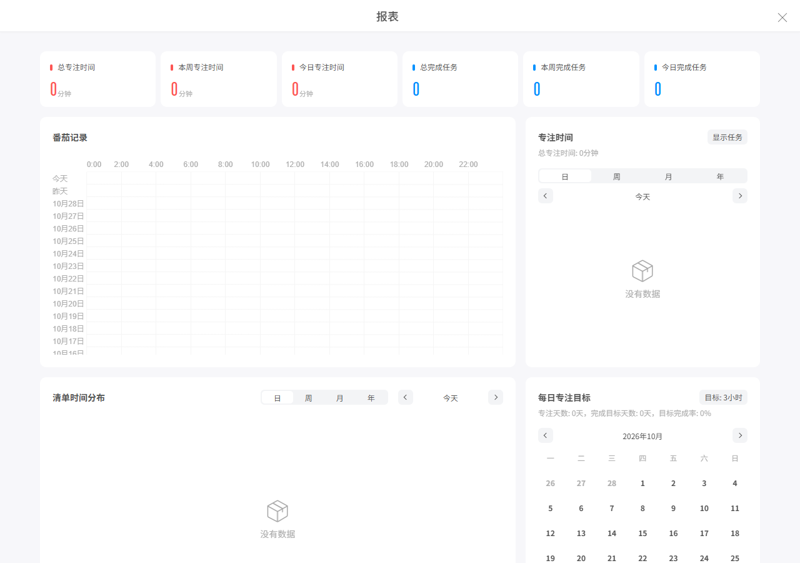
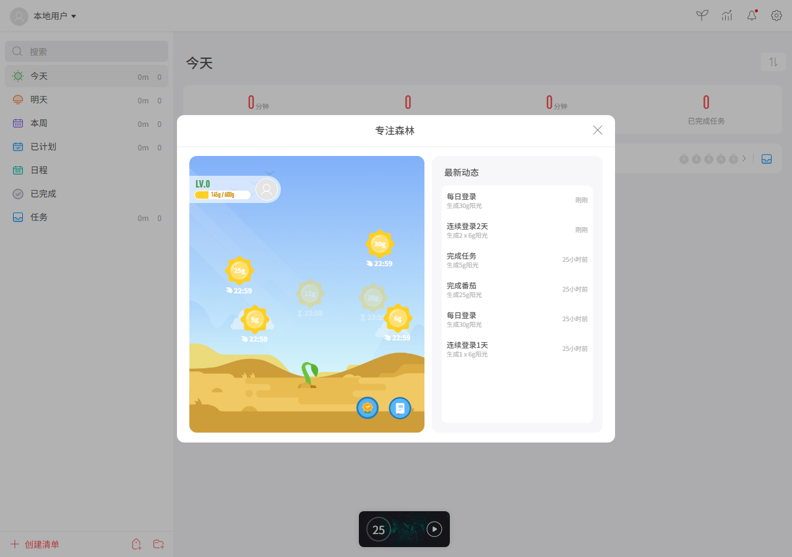
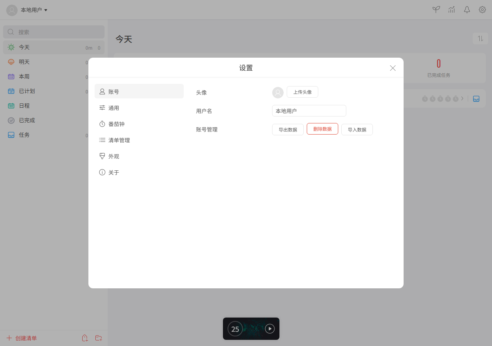
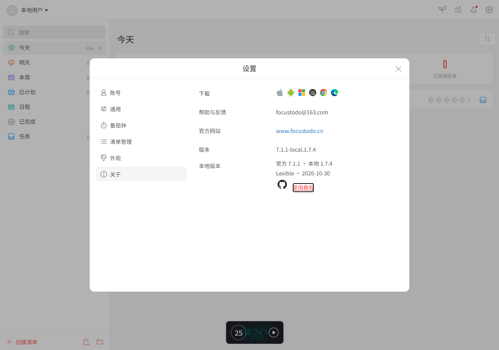

# FocusTodo local edition: user guide

[Home](../../README_en.md) · [中文](../GUIDE.md) · [Changelog](CHANGELOG.md)

This guide follows the main screen, tasks, timer, reports and settings, with calendar, forest and backup instructions for the local edition. Its organization is inspired by [Lexible's Windows guide](https://zhuanlan.zhihu.com/p/31498089). Screenshots contain isolated test data; dates and counts are examples.

## Concepts and first steps

A pomodoro is a period of focus followed by a break. A task is a concrete piece of work; a list groups related tasks. Open [GitHub Pages](https://menggou1.github.io/FocusTodo-Local/) or follow the [startup instructions](../../README_en.md#quick-start). No account is required. Keep the same browser, host and port to see the same local data.

The sidebar contains search, date/status views, Calendar and custom lists. The middle contains statistics, task entry and the current list. The upper-right icons open forest, reports, notifications and settings; the compact timer sits at the bottom.

## Tasks and reminders

Select a list, enter a task at the top and press Enter. Choose an estimated number of pomodoros, list or date as needed. Click a task for its title, due date, list, reminder, repeat, subtasks and notes. Press Enter to add a subtask; click away to save a note. Use the completion circle to finish a task and the play icon to focus on it. Right-click for more actions or drag to reorder. Completed tasks can be reviewed and restored.

A due date organizes a task; a reminder alerts you at a chosen time. The bell shows due reminders and updates. For desktop alerts, enable notifications in Settings → General and allow them in the browser and operating system.

## Focus and breaks

Start the timer from a task or use the compact timer without a task. Depending on its state, controls start, pause, resume, stop or begin a break. Switch between compact and expanded views, and adjust work and break durations in Settings → Pomodoro. Removing the task association does not delete the task. Stopping resets the timer and saves a qualifying segment. After an interruption over five minutes, choose whether to count the interrupted time; time does not continue while awaiting that decision.

## Calendar

Open Calendar in the sidebar. Navigate dates and views to inspect plans and completed records. In day view, drag over an empty time range or double-click to create a task and its schedule; cancel to discard. Existing plans can be moved, resized, opened or started with the play control. Overlapping plans appear in columns.

## Reports and forest

Use the report icon to review saved focus time, completed tasks, distribution and trends.

Enable Focus Forest in Settings → General and open it from the top bar. Focus records, completed tasks and local logins can generate sunlight; collect it after it matures and before it expires. The in-app guide explains the rules. Local achievements award sunlight once for focus, completed tasks and dates with focus records. Groups and online rankings are unavailable in this edition.

## Settings and backups

General controls language, forest and notifications; Pomodoro and sound controls adjust focus and alerts. Appearance and list management control themes, wallpaper and system lists. Account holds the local name/avatar and backup controls; it does not provide account sync. About links to the repository and this guide.

1. Under Settings → Account, export a complete backup. The default is `.json.gz`; plain JSON and wallpaper omission are options.
2. Check the browser downloads folder and keep the file safely, especially before clearing site data or changing browser/address.
3. On the destination, use Settings → Account → Import, inspect the displayed scope, then confirm replacement. Pages and loopback have separate storage.
4. Import and deletion initiate a full safety backup; verify the downloaded file. Deletion requires a delay and confirmation.

Imports recognize legacy JSON and Gzip by content. Gzip import requires decompression support; both encoded and decoded data are limited to 128 MB. Images remain subject to browser storage quota. A backup without wallpaper restores the built-in theme. For versions and verification details, see the [changelog](CHANGELOG.md).
